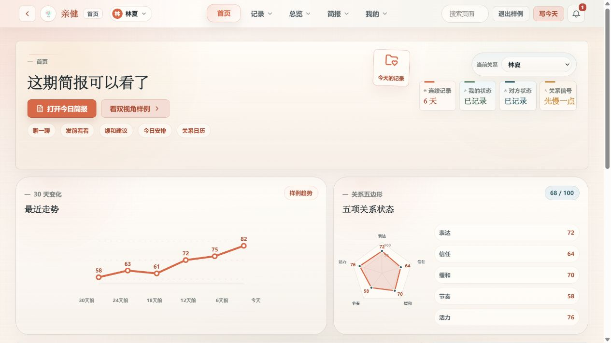
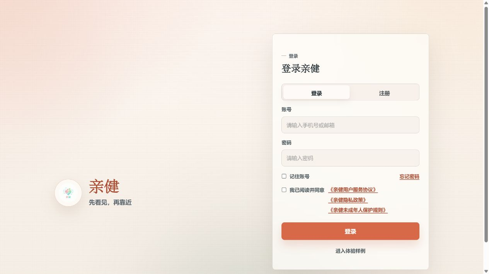
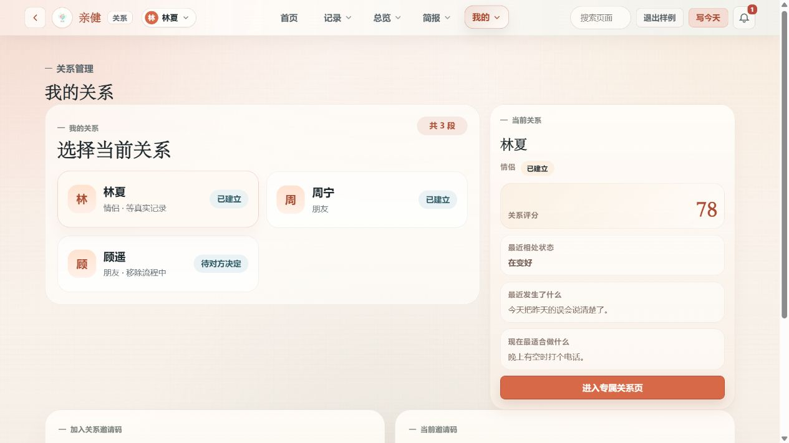
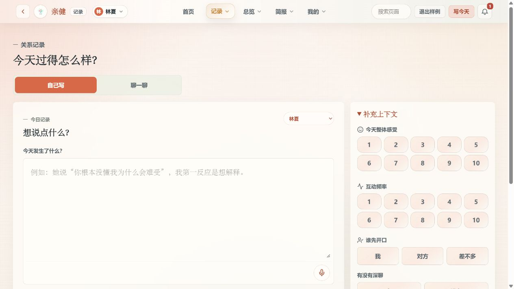
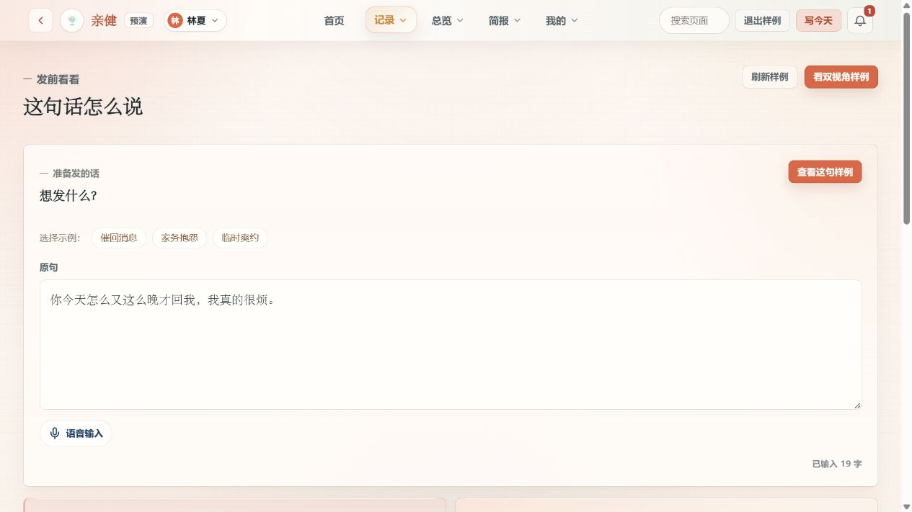
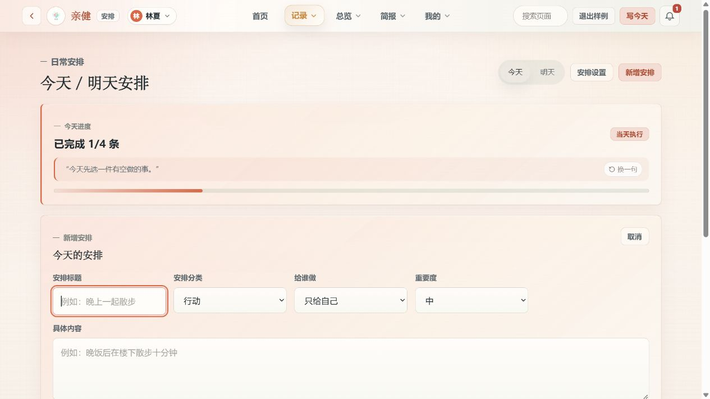
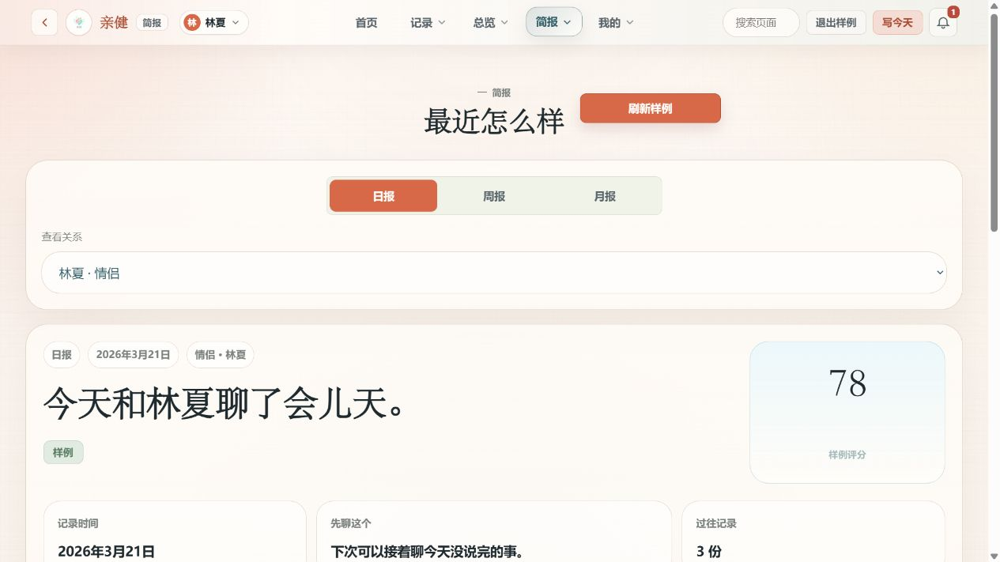

# 亲健（基于生成式 AI 的泛亲密关系智能感知与维系系统）

版本号：V1.0

文档名称：软件设计与操作说明书

著作权人：黄菁蓝

开发完成日期：2026年9月21日

## 1 软件概述

本文说明亲健的主要功能、数据处理方式和常用操作。界面图片取自软件在浏览器中的实际运行页面；截图中的姓名、记录、分数和日期均为内置示例数据。

亲健用于记录日常相处情况、整理沟通内容和管理后续行动。用户可以单独记录自己的近况，也可以通过邀请建立两人的关系空间。在关系空间中，双方分别提交记录，查看相应简报，并对沟通建议和日常任务作出选择。

用户可以填写文字、选择心情和互动情况，也可以上传图片或语音。记录按用户、关系空间和日期保存。对话、表达预演和简报功能读取授权范围内的记录，调用后台配置的模型服务生成回复或建议，由用户决定是否采用。

本软件采用浏览器访问方式。前端负责页面展示、输入校验和结果呈现，后端负责身份验证、业务处理、数据存储及外部服务调用。软件将个人记录与关系记录分开处理；没有建立关系空间的用户可以使用个人记录和个人会话。

### 1.1 功能组成

表 1 主要功能

| 功能 | 主要处理内容 |
| --- | --- |
| 账号与资料 | 注册、登录、身份验证及个人资料维护 |
| 关系空间 | 生成邀请码、预览邀请、提交加入请求及处理关系变更 |
| 日常记录 | 保存文字、心情、互动信息及图片、语音引用 |
| 对话 | 建立会话、保存消息、读取历史内容并返回回复 |
| 表达预演 | 分析待发送文字，返回风险解释、改写及行动建议 |
| 日常任务 | 创建安排、修改日期、记录完成状态与实际反馈 |
| 周期简报 | 按个人或关系范围生成简报，查询历史与趋势 |
| 时间轴 | 按时间汇集记录和事件，查看摘要与具体内容 |
| 双视角分析 | 分别整理双方记录，提示可能的误读和下一步说法 |
| 缓和建议 | 根据当前状态整理分步建议、注意事项和求助入口 |
| 关系协作智能体 | 读取已授权上下文、调用工具并提出需要确认的行动 |
| 关系体检与依恋倾向 | 通过问答和已有记录整理各项得分、变化趋势及参考说明 |
| 异地与重要节点 | 保存联系安排、异地互动、纪念日和关系中的重要时刻 |
| 关系成长树 | 根据记录和可领取节点更新成长值、阶段和进度 |
| 关系技巧与通知 | 查看系统整理的沟通技巧，接收关系空间内的提醒 |
| 隐私管理 | 管理输入处理方式、文件访问、审计记录和删除申请 |

### 1.2 数据使用范围

个人记录以用户编号区分，关系记录以关系空间编号区分。接口先确定当前登录用户，再检查其与目标数据的关系。用户在前端切换关系空间时，页面请求会携带相应的关系编号，后端重新验证访问权限。

用户记录、分析结果和任务反馈分别保存。任务接口负责更新完成状态及反馈内容。简报用于回顾已有记录，不作为医疗诊断结果。

### 1.3 首页入口

进入首页后，先确认顶部显示的当前关系。首页汇总记录状态、近期走势和当天安排，导航栏用于进入今日记录、功能总览、简报和个人页面。切换互动对象后，应再次确认页面显示的姓名，再查看对应内容。

### 1.4 功能入口与使用范围

登录后从首页进入核心功能。今日记录用于保存当天发生的事；关系简报和时间轴用于回看已经保存的内容；“发前看看”“双视角分析”和“缓和建议”用于整理沟通前后的信息。功能总览还提供关系体检、依恋倾向、异地关系、重要节点和关系技巧等入口。

没有建立关系空间时，用户仍可以使用个人记录、个人会话、单人时间线和单人安排。涉及双方比较、双方依恋倾向或关系健康指数的页面，会在缺少关系或记录不足时显示原因，不把个人结果当成双方结果。处于体验样例时，页面使用内置数据并标明样例；样例数据不会写入真实账号。

页面上的分析、改写和建议都属于辅助结果。用户可以重新整理、修改输入或直接不采用。系统只在用户明确确认后创建安排，也不会替用户向关系中的另一方发送消息。

## 2 系统结构

### 2.1 前后端分工

前端使用 Vue 3 构建页面，通过 Vue Router 管理页面跳转，通过 Pinia 保存当前账号、关系空间、记录和简报等页面状态。Axios 负责发送接口请求。页面收到响应后更新列表、表单和状态提示；请求失败时保留必要输入并显示错误信息。

后端使用 FastAPI 提供接口。请求模型负责解析参数，身份依赖负责识别用户，业务接口调用相应服务处理关系、记录、会话、任务和报告。SQLAlchemy 将业务对象映射到数据库，Alembic 管理数据库结构变更。

模型调用集中在后端处理。浏览器不保存模型服务密钥，也不直接请求模型服务。后端根据任务类型组织消息，处理返回内容，再转换成前端使用的响应字段。

表 2 系统组成

| 层次 | 组成 | 职责 |
| --- | --- | --- |
| 页面层 | Vue 3、Vue Router、Pinia | 显示页面、收集输入、管理页面状态 |
| 接口层 | FastAPI、Pydantic | 路由、参数校验、身份验证和响应整理 |
| 业务层 | 关系、记录、会话、任务、简报等服务 | 执行业务规则并协调数据读写 |
| 数据层 | SQLAlchemy、PostgreSQL、SQLite | 保存账号、关系、记录及处理结果 |
| 外部服务层 | 文本模型、图片分析和语音服务接口 | 按服务配置处理指定任务 |
| 部署层 | Docker Compose、Nginx、Redis | 启动各项服务、转发请求及保存共享状态 |

### 2.2 一次请求的处理过程

用户在页面提交输入后，前端向后端发送 JSON 请求。涉及账号数据的请求携带访问令牌。后端解析令牌中的用户编号并查询用户记录；令牌无效或用户不存在时，接口返回身份错误。

关系空间中的操作仅向该关系的参与者开放，并受当前关系状态限制。符合条件的请求由业务服务读取或更新数据，结果随后显示在页面上；无法处理时，页面说明具体原因。

耗时较长的分析通过后台任务处理。接口先保存输入或建立待处理报告，再返回当前状态。前端随后读取处理结果。因此，记录保存完成和报告生成完成是两个独立状态。

### 2.3 程序组织

后端按接口、数据模型、请求响应模型、业务服务和模型调用模块划分目录。接口层处理请求入口，服务层处理可复用的业务逻辑。邀请码生成、时间换算、身份令牌和数据库连接等公共功能集中维护。

前端按页面、组件、状态仓库、接口封装和工具函数划分目录。表单与展示逻辑放在对应页面中，任务提案、结果录入等重复交互由组件实现。请求参数和返回值转换通过接口封装处理。

## 3 账号与访问控制

### 3.1 注册和登录

用户注册时提交账号、昵称和密码。账号识别逻辑区分手机号与邮箱，注册接口检查昵称、密码长度及账号是否已存在。校验通过后，密码通过 bcrypt 生成哈希值，数据库保存哈希结果。

用户登录时，后端根据账号查询用户并校验密码。登录成功后返回访问令牌及用户信息。令牌使用 JWT 格式，包含用户编号、签发时间、生效时间和过期时间。后续受保护接口校验令牌后取得当前用户。

登录失败次数分别按账号和网络来源记录。达到对应限制时，接口暂时拒绝继续尝试并返回等待提示。登录成功后清除当前账号的失败记录。前端收到身份过期提示时，需要重新取得有效登录状态。

### 3.2 关系数据访问

关系空间记录两名参与者的用户编号。访问空间内的数据时，后端比较当前用户编号与参与者编号；不属于该空间的用户不能读取相应数据。要求关系已生效的接口还会检查关系状态。

会话、任务和上传文件有各自的归属检查。会话读取以会话所属用户为依据，任务更新检查当前用户是否能够操作该任务，上传引用检查文件是否属于当前用户或允许访问的空间。前端传入的数据编号仅用于定位对象，不能代替权限验证。

### 3.3 登录操作

在浏览器中访问 https://qinjian.tech，在登录页填写账号和密码。阅读相关协议并勾选同意后，点击“登录”。需要新建账号时切换到“注册”。“进入体验样例”用于浏览内置示例，示例中的记录不代表当前用户的实际情况。

## 4 关系空间设计

### 4.1 邀请与加入

用户创建邀请时，后端建立待加入的关系记录并返回邀请码。如果该用户已有尚未使用的待邀请关系，接口返回已有记录。邀请码长度为 10 位，由数字和大写字母组成；输入时先去除首尾空白并统一为大写，再进行校验。

接收方填写邀请码后，先查看邀请人的基础信息，再提交加入申请和希望建立的关系类型。后端记录申请人、确认人和申请状态。此时关系仍处于待确认状态，邀请发起方处理申请后才确定加入结果。

加入请求提交后，系统更新邀请码并发送站内提示，避免同一邀请继续被其他人使用。邀请发起方也可以在待邀请状态下刷新邀请码，刷新操作受到频率限制。

### 4.2 变更请求

加入、关系类型调整和结束关系分别通过变更请求记录。请求保留所属关系、请求类别、发起方、处理方、创建时间和处理时间。对方接受、拒绝或发起方撤回请求后，系统保存处理结果，关系页面同步显示最新状态。

表 3 关系变更请求状态

| 请求状态 | 含义 | 后续处理 |
| --- | --- | --- |
| pending | 请求等待处理 | 按请求类别接受确认、拒绝或撤回操作 |
| approved | 请求已通过 | 依据请求类别更新关系状态或类型 |
| rejected | 请求未通过 | 保留结果供双方查看 |
| cancelled | 发起方已撤回 | 结束本次请求处理 |

结束关系的请求另行保存处理阶段、截止时间和原因。程序按当前阶段处理回应、挽留、撤回或到期结果，关系页面显示对应状态和可执行的操作。

### 4.3 多关系切换

“我的关系”列出用户参与的各段关系，并区分已建立关系和待处理申请。选中一段关系后，其他页面显示该关系的内容。关系类型、对方昵称和用户为对方设置的备注分别保存，修改备注不会修改对方的账号资料。

关系切换只改变当前页面的查询范围，不会把上一段关系的记录带到新的关系中。页面重新读取当前关系的摘要、当天记录和待处理事项；如果切换期间关系状态发生变化，接口返回最新状态，页面提示用户重新选择可用操作。

### 4.4 查看和选择关系

从“总览”打开“我的关系”，查看各段关系及其状态。点击关系条目后，检查当前关系名称，再进入专属关系页。邀请和加入操作位于同一页面下方；尚待确认的请求会显示相应状态，不等同于已经建立关系。

## 5 日常记录设计

### 5.1 输入内容

日常记录包含文字内容、心情选项、互动频次、互动主动方、是否有深入交谈以及任务完成情况。图片和语音先通过上传接口取得文件引用，再随记录提交。后端会核对引用归属，不直接接受任意外部文件地址作为已上传附件。

记录同时包含客户端处理信息，例如输入类型、隐私模式、上传策略和预检结果。后端根据请求和用户偏好确定最终保存的文字及相关上下文。个人记录不关联关系空间；关系记录必须关联当前用户有权访问的空间。

### 5.2 保存流程

后端按照本地日期查询当前用户当天是否已有同范围记录。个人范围按用户和日期查询，关系范围按关系、用户和日期查询。若已存在记录，接口返回当天已提交的提示，避免同一范围重复创建。

记录保存内容包括文字、附件引用、心情和互动情况，以及供时间轴展示的归档信息。情感分析在后台执行，记录提交响应不等待分析完成。分析结果与原始输入分开表示，响应中可以区分客户端预检、服务端分析和最终提示。

表 4 日常记录主要字段

| 字段 | 用途 |
| --- | --- |
| user_id | 标识记录提交人 |
| pair_id | 标识所属关系；个人记录为空 |
| checkin_date | 标识记录所属日期，用于当天状态和周期查询 |
| content | 保存按当前输入策略处理后的文字 |
| image_url、voice_url | 保存图片和语音的文件引用 |
| mood_score、mood_tags | 保存用户选择的心情信息 |
| interaction_freq、interaction_initiative | 保存互动频次与主动方 |
| client_context | 保存预检、输入类型和隐私策略等上下文 |

### 5.3 后续处理

个人记录保存后，系统可建立对应的个人简报任务。关系记录保存后，程序检查另一方是否也完成当天记录；满足相应条件时，再组织双方记录生成日简报。记录与报告通过所属范围和日期对应。

历史查询只读取当前用户有权访问的数据。页面显示记录时间、归档摘要及允许展示的内容，打开附件时仍需校验文件访问权限。

### 5.4 填写日常记录

从导航栏进入记录页面，选择记录对象，在“今天发生了什么”中填写内容。根据实际情况选择心情，并按需补充整体感受、互动频率、谁先开口等信息。检查内容与对象后点击“保存记录”。文字尚未填写时，保存按钮不可用。

填写前先核对记录对象。个人记录用于保存自己的近况；关系记录用于描述与当前所选对象的相处情况。记录会归入对应的范围，不能仅凭文字里提到的姓名判断归属。选择对象后，再填写具体发生的事和自己的感受。

点击保存后，等待页面返回结果。如果提示当天已经提交，先查看已有记录；如果提示附件无法使用，检查图片或语音是否已上传成功。记录保存与简报生成分开进行，暂时没有简报不代表记录没有保存，不必因此重复提交。

## 6 会话与表达预演

### 6.1 会话管理

用户进入对话页面后，系统为个人范围或指定关系建立会话。会话保存所属用户、关系编号、主题和最近活动时间。每条消息保存角色、正文、创建时间及必要的附加数据，历史消息按会话查询。

每条新消息可以附带唯一编号，用于识别重复提交。相同编号的请求会根据已有处理状态返回结果、提示等待或重试失败的消息。相同编号对应的正文或场景信息发生变化时，接口要求作为新消息提交。

表 5 会话消息处理状态

| 消息处理状态 | 后端处理 |
| --- | --- |
| processing | 该消息正在处理；重复请求返回稍后重试提示 |
| completed | 保存回复编号；相同请求可以读取已有回复 |
| failed | 记录失败；符合重试条件时重新处理 |

生成回复前，服务读取当前会话及允许使用的背景资料，组织模型输入。返回结果经整理后写入消息记录，再返回前端。模型服务异常时，接口记录本次处理失败，不将尚未生成的回复记为完成。

### 6.2 表达预演

表达预演用于处理用户准备发送的文字。用户输入草稿并发起分析后，系统返回风险等级与原因、对方可能的理解、可能影响、建议改写及适合采用或避免的做法。页面保留原句，便于用户比较。

预演接口结合用户选择的个人或关系范围组织背景。结果中的风险解释和对方视角属于系统提供的参考，用户可以调整判断、换一种表达或选择不用。系统保存用户的选择反馈，用于后续查看和处理。

预演结果保留在当前页面供用户查看，软件不会自动向对方发送这些内容。

### 6.3 从会话创建任务

对话可以返回任务提案。提案先以候选内容展示，包含建议事项和必要的安排信息。点击“加入安排”即表示确认提案。系统确认提案属于当前会话后，将其保存为任务，并记录任务编号。未确认的提案不作为已建立任务显示。

确认前，用户可以继续补充情况或调整目标。任务创建后，通过任务模块修改日期、记录完成情况和填写反馈。

### 6.4 使用发前看看

从“总览”打开“发前看看”，输入准备发出的原话，再发起分析。页面依次展示风险说明、对方可能的理解和改写建议。用户可以修改原话后重新查看，也可以不采用建议。系统不会代替用户向对方发送这条消息。

### 6.5 语音输入与附件

“发前看看”和会话页面都支持把语音转成文字后继续编辑。点击语音输入按钮后，前端优先建立短时实时转写连接；连接不可用时按浏览器能力切换到本地语音识别。转写过程中显示当前状态，停止录音后把最终文字合并到输入框，用户可以修改后再提交。转写失败时保留已有文字，不把失败结果当成完整内容。

日常记录支持图片和语音附件。文件先通过上传接口取得文件编号和受保护的访问地址，再随记录提交。图片可以进入图像分析流程，语音可以进入转写流程；分析和转写结果与原始文件分开保存。页面只使用服务返回的临时地址，地址过期后重新申请，不直接暴露服务器文件路径。

### 6.6 关系协作智能体

关系协作智能体页面提供三个场景入口：描述今晚想怎么开口、检查已经写好的话，以及寻找压力较小的关心方式。打开场景后，页面可以进入真实对话；点击“证据与推理”后，可以查看本次分析所参考的关系状态、历史事件及相关风险信息。

智能体按照“读取授权信息、判断风险、提出小行动、等待确认”的顺序处理。后台会保存会话、消息、工具调用和处理状态，必要时返回行动提案。行动提案只展示标题、说明、日期和适用范围；用户确认后才调用任务接口创建安排。重复确认会读取已经创建的任务，避免同一提案重复建立。高风险信号会优先显示转介或求助提示，不继续生成可能增加压力的行动。

智能体还提供技能分析、提案选择和复核入口。技能结果属于候选建议，页面会保留来源和当前状态；任何建议都不能绕过当前用户的关系权限，也不能代替用户发送消息。

## 7 日常任务设计

### 7.1 创建和修改

任务保存标题、说明、所属关系、适用用户、来源、安排日期和状态。用户可以手动建立安排，也可以确认对话中的提案后创建任务。创建接口检查操作范围及当天任务容量，再保存任务。

任务列表按适用范围和日期读取，页面显示标题、说明及当前状态。修改接口先检查任务是否存在及当前用户是否有权操作，再更新允许修改的内容。服务根据任务来源和目标范围判断可见性，不把所有任务都展示给关系中的每一个用户。

### 7.2 完成与反馈

用户完成安排后，可以记录结果和实际感受。任务结果接口先检查任务状态及日期：已取消的安排不能继续修改结果，尚未到计划日期的安排不能提前填写结果。

完成状态和反馈一起保存，避免只更新其中一项。保存失败时两项均保持原状；撤销完成状态后，任务恢复为待完成。

反馈关联任务编号、所属关系和提交人。清除反馈时，系统删除相应的私人文本，保留操作标记，并刷新相关资料。

### 7.3 新增和查看安排

从首页打开当天安排，或从“总览”进入“每日安排”。先选择今天或明天，再点击“新增安排”，填写标题、分类、执行对象、重要度和具体内容，最后保存。完成后通过“更新结果”记录实际情况，未完成的安排不应直接标为完成。

## 8 简报与时间轴

### 8.1 简报范围和周期

简报包含个人简报、关系日简报、周简报和月简报。生成前先确定当前用户与查询范围，再按对应日期读取输入记录。普通关系日简报要求双方完成当天记录；缺少所需输入时返回提示。

报告记录保存类型、日期、所属范围、处理状态和结果内容。新建报告显示为待处理，正文和相关指标由后台生成。生成完成后，用户即可查看摘要、建议和相应图表。

### 8.2 报告状态

表 6 简报生成状态

| 状态 | 页面含义 | 处理方式 |
| --- | --- | --- |
| pending | 已建立报告，等待或正在生成 | 页面继续查询结果 |
| completed | 已取得报告内容 | 展示内容并允许回看 |
| failed | 本次生成未完成 | 显示失败提示，按接口支持的方式重新发起 |

相同范围、类型和日期已有待处理或已完成报告时，生成接口可以返回已有记录。失败报告按对应接口的重建逻辑处理。查询接口分别提供最新结果、历史列表和趋势数据。

### 8.3 时间轴

时间轴将日常记录、报告及关系事件按时间组织。归档信息包含标题、摘要和标签，页面可以先展示简要内容，再按条目类型查看详细信息。用户切换个人范围或关系范围时，读取的数据集合随之改变。

时间轴接口在组织条目时执行相应的可见性处理。原始记录、系统摘要和任务反馈是不同的数据来源，页面使用条目类型和时间标识区分，不将系统生成的描述写回为用户原始输入。

用户点击时间轴条目时，页面按条目类型打开记录、报告或任务详情。详情页显示的数据仍由后端按当前用户和关系范围过滤；删除或撤回后的内容不会因为浏览器保留旧页面而继续显示为可操作状态。

### 8.4 查看简报

从导航栏进入“简报”，选择日报、周报或月报，并确认要查看的关系。页面显示对应周期的摘要、记录日期和建议，向下滚动可以继续查看趋势及历史简报。处于体验样例时，页面会标明“样例”，显示的是预置内容。

### 8.5 双视角分析

从首页或功能总览进入“双视角分析”后，系统读取当前关系中双方已经提交的记录，分别整理“我的视角”和“对方的视角”。结果页包含共同经历、可能的误读、分歧点、参考说法和下一步行动。用户可以切换视角，也可以跳回对应日期的记录查看原始输入。

分析结果带有生成日期、记录范围和结果来源。记录不足、关系未生效或本次生成失败时，页面显示对应原因并保留上一次可用结果（如果存在）。建议说法可以再次调整，用户的反馈单独记录，不会改写原始记录。

### 8.6 关系体检与依恋倾向

关系体检先让用户选择“先看自己”或某段已建立关系，再逐题回答。页面显示当前题号和所属维度，最后返回综合分、各维度分数、雷达图、近期变化和本次建议。体检记录按用户或关系保存，可在下一次测试时查看趋势。结果用于回顾和沟通准备，不作为医疗诊断。

依恋倾向页面根据已有记录整理个人倾向；在双方关系中，双方各自的结果分开显示。记录数量不足时，页面提示还需要留下多少记录，不能用空结果推断倾向。样例账号直接使用预置结果，真实账号通过受保护接口请求分析。

## 9 数据存储设计

### 9.1 主要数据表

数据库采用用户编号和关系编号建立业务关联。用户资料保存在账号表，参与者和关系状态保存在关系表。记录、报告、任务及事件根据各自的使用范围关联用户或关系。

表 7 主要数据表

| 数据表 | 关键内容 | 关联用途 |
| --- | --- | --- |
| users | 账号、昵称、密码哈希、头像、偏好 | 标识登录用户 |
| pairs | 双方用户编号、关系类型、状态、邀请码 | 组织关系空间 |
| pair_change_requests | 请求类别、处理人、状态和时间 | 保存加入及关系变更过程 |
| checkins | 记录正文、日期、心情、互动情况 | 保存每日输入 |
| reports | 报告类型、日期、状态、结果 | 保存周期处理结果 |
| agent_chat_sessions | 用户、关系、主题和会话状态 | 组织对话历史 |
| agent_chat_messages | 会话、角色、正文和附加数据 | 保存会话消息 |
| relationship_tasks | 标题、适用用户、安排日期和状态 | 管理日常安排 |
| relationship_events | 事件类型、关联对象和内容 | 组织记录、反馈与操作事件 |
| relationship_trees | 所属关系、成长值、阶段和节点信息 | 保存关系成长树状态 |
| upload_assets | 文件路径、所属用户、关系与范围 | 判断附件引用和访问权限 |
| privacy_deletion_requests | 申请人、处理状态和计划时间 | 记录删除申请过程 |

### 9.2 关联方式

一个用户可以提交多条记录，也可以参与多个关系空间。关系表中的两个用户编号分别指向参与者。关系变更请求关联关系编号，并单独记录发起方与处理方，便于查询当前等待谁处理。

一条会话可以包含多条消息。消息角色区分用户输入和系统回复，附加数据保存处理状态或任务提案。任务反馈通过事件记录与具体任务关联，查询时同时限制所属关系和提交人。

记录表和报告表的关系编号允许为空，用于个人范围。报告还记录用户编号，使个人简报能够按用户独立查询。系统不会仅依靠日期将不同用户的记录合并。

### 9.3 结构变更与数据一致性

数据库结构通过迁移脚本更新，业务程序通过模型读写数据。涉及多项关联更新的操作由事务协调，避免关系请求与关系状态、任务结果与反馈出现部分写入。

接口以数据库中保存的状态为准。若页面状态已过期，接口返回错误原因，页面重新查询数据或提示用户调整操作。

### 9.4 关系成长树与重要节点

关系空间可以显示一棵关系成长树。树的阶段、成长值、进度和已记录节点保存在关系树数据中；首页展示可领取的成长节点，用户点击后由接口再次检查节点是否存在、是否已经领取以及当前用户是否有权操作。成长值达到下一阶段时记录阶段变化，重复领取不会重复增加成长值。

“关系纪念日”页面保存纪念日、重要承诺、关系起点和自定义节点。成对关系的节点保存到关系空间；没有关系空间时，节点只保存在当前账号的单人时间线中。列表按日期倒序显示，标题和日期为空时不允许保存。

## 10 隐私与文件访问

### 10.1 输入处理

系统根据用户偏好和服务配置决定输入处理方式。文字在进入模型服务前可以经过敏感信息替换；客户端预检和服务端处理结果分开保存。隐私状态接口返回当前脱敏、审计及上传访问配置，页面据此显示状态。

采用本地优先配置时，部分功能仍需请求外部模型或语音服务。相关调用由后端执行，连接地址、凭据和模型名称通过部署配置提供。

### 10.2 上传文件

上传文件保留所属用户、关系范围、存储路径和文件类别。记录引用附件时检查归属，读取附件时检查访问凭据和授权范围。服务可以生成具有有效期的文件访问地址，前端使用返回地址显示图片或播放语音。

文件访问地址失效后，页面需要重新取得有效地址。使用文件编号或存储路径不能绕过归属检查。日志记录和审计信息按对应配置处理，不把上传文件内容直接作为普通请求日志输出。

### 10.3 删除申请与审计

隐私中心提供状态查询、本人审计记录查询、创建删除申请和撤回申请接口。删除申请保存提交时间、计划处理时间及状态。已有待处理或人工复核中的申请时，系统返回已有申请，避免重复创建。

允许撤回的申请在撤回后记录取消时间。申请提交、撤回、查看状态等操作可写入隐私审计记录。提交删除申请与数据实际删除分别记录，页面以申请的当前状态显示处理进度。

### 10.4 隐私中心的操作

从个人页面进入“隐私与安全”，可以查看图片和音频的保存方式、分析结果的保存方式、原件下载限制、上传访问权限和审计是否开启。用户可以关闭“辅助整理”；关闭后仍保存用户主动提交的记录，但不再按该偏好继续整理辅助结果。

页面显示最近的隐私操作和日期。体验样例中的状态和审计记录只在当前样例会话内展示；真实账号通过 `/privacy/status` 和 `/privacy/audit/me` 读取。删除申请提供当前状态、提交时间和可撤回状态，撤回不会伪装成已经完成删除。

## 11 接口与异常处理

### 11.1 主要接口

接口使用统一的 /api/v1 前缀。下表列出主要业务入口；需要身份验证的接口在请求中携带访问令牌，关系业务另行校验关系编号和参与者。

表 8 主要业务接口

| 请求 | 接口路径 | 用途 |
| --- | --- | --- |
| POST | /auth/register | 注册账号 |
| POST | /auth/login | 验证账号和密码 |
| GET | /auth/me | 读取当前用户 |
| POST | /pairs/create | 创建或读取待邀请关系 |
| POST | /pairs/join/preview | 预览邀请码对应的邀请 |
| POST | /pairs/join | 提交加入申请 |
| GET | /pairs/me | 查询本人的关系列表 |
| POST | /checkins/ | 提交当天记录 |
| GET | /checkins/history | 查询记录历史 |
| POST | /agent/sessions | 建立或取得会话 |
| POST | /agent/sessions/{session_id}/chat | 提交会话消息 |
| POST | /agent/simulate-message | 进行表达预演 |
| POST | /tasks/manual/{pair_id} | 新建安排 |
| POST | /tasks/{task_id}/result | 保存任务结果与反馈 |
| POST | /reports/generate-daily | 发起日简报生成 |
| GET | /reports/history | 查询历史简报 |
| GET | /privacy/status | 查询当前隐私配置和申请状态 |
| POST | /privacy/delete-request | 创建删除申请 |

### 11.2 错误响应

请求参数不符合模型要求时，接口返回参数错误。身份无效时返回未认证提示，无权访问对象时返回权限提示，对象不存在时返回未找到提示。重复记录、过期请求或状态不允许操作等情况，由业务接口返回具体原因。

页面根据错误信息提示用户检查输入、重新登录、刷新数据或稍后重试。对已经写入的记录，后续分析失败不等于记录未保存；页面需要分别读取保存状态与分析状态，避免再次提交相同内容。

### 11.3 外部服务异常

模型和语音服务可能出现连接失败、超时或响应内容无法解析的情况。对应模块捕获异常并按业务要求返回错误或可用的规则结果。不同业务的处理方式分别定义：会话保留失败状态供后续重试，报告记录生成状态，预演按响应结构提供结果来源和相关提示。

## 12 运行与部署

系统后端运行于 Python 环境，主要使用 PostgreSQL 保存业务数据，并使用 Redis 支持部分共享状态和请求控制。前端通过 Vite 构建静态文件，由 Web 服务提供访问。开发环境也支持使用 SQLite 保存数据。

部署时分别配置数据库连接、身份令牌密钥、上传目录及外部服务参数。Nginx 接收浏览器请求，将接口请求转发到后端，并提供前端静态文件。数据库结构通过迁移脚本更新后再启动业务服务。

服务提供健康检查接口，部署人员可以查看服务响应及日志判断运行状态。数据库与上传文件分别保存，需要在备份和恢复时保持对应关系。恢复后，应使用相应账号检查记录、附件、关系状态和任务结果能否正常读取。

### 12.1 常见问题

无法登录时，先检查账号、密码和网络连接。输入无误但仍无法登录时，应根据页面提示处理，不要反复创建账号。

查看不到关系记录时，先确认当前互动对象，并检查关系是否已经建立。个人记录与关系记录的查看范围不同，切换关系不会改变记录原来的归属。

简报暂时没有内容时，先检查该周期是否已有记录，并查看报告状态。如果后台仍在处理，稍后再查看；显示失败时按页面提示重试。

分析请求超时或服务不可用时，页面可能返回基础提示或错误信息。此时不能把基础提示当作模型已经完成分析，也不应反复提交相同内容。

## 13 其他功能与运行边界

### 13.1 异地关系

“异地关系”页面读取当前关系的健康指数和近期互动安排。用户可以选择视频通话、同步吃饭、分享照片等联系方式，创建一次同步安排；安排保存后显示进行中或已完成状态。没有关系空间时，页面把相同操作保存为个人联系计划，不调用双方接口。健康指数缺少数据时显示空状态，不用默认分数代替。

### 13.2 关系技巧与消息提醒

“关系技巧”页面从后端读取可用的建议，并支持刷新或换一句。用户可以查看与当前关系有关的提醒；点击带有目标页面的提醒时，页面跳到相应功能，点击后可标记为已读。技巧和提醒是辅助内容，不能修改记录、关系状态或任务结果。

### 13.3 结果来源与服务不可用时的处理

每类结果都有自己的来源和状态。体验样例使用内置数据，页面会显示“样例”；真实账号的接口结果显示处理状态；模型服务不可用时，页面可能返回规则化的基础提示或暂时保留上一次结果。基础提示、备用结果和模型生成结果在响应中分开标识，避免把备用内容当成已经完成的分析。

页面的刷新操作有次数或时间限制。短时间内重复请求时，接口返回等待提示，前端保留当前页面内容。浏览器刷新、重新登录或切换关系后，页面重新从服务端读取范围和权限，不以旧页面中的关系编号代替权限检查。

### 13.4 运行检查

部署后可以访问 `/api/health` 检查后端是否在线，再打开首页、登录页、记录页、简报页和隐私页做基本检查。检查内容包括登录状态、关系切换、记录保存、附件访问、报告状态和退出后的权限限制。前端由 Nginx 提供静态资源，接口由后端容器处理；数据库和上传目录需要分别备份，恢复后再用普通账号核对记录与附件的对应关系。
