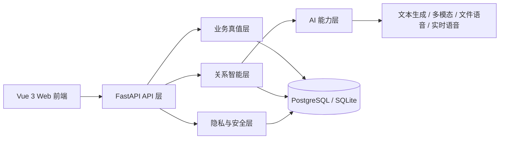
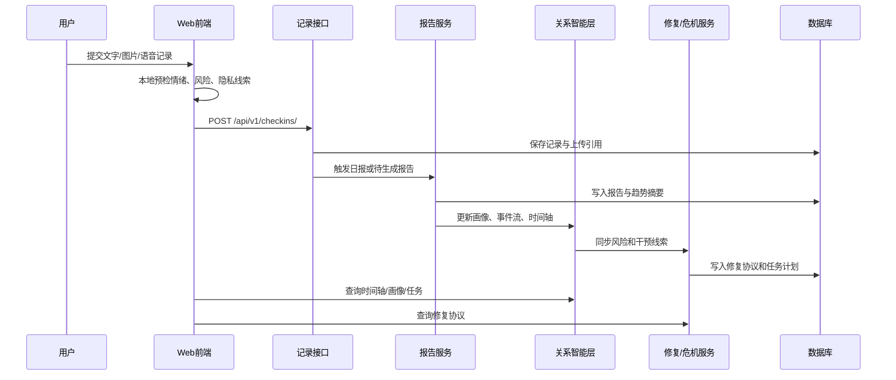

# 亲健（基于生成式 AI 的泛亲密关系智能感知与维系系统）
## 软件架构设计与系统实现说明书

> 编制单位：亲健软件研发团队  
> 完成日期：2026年09月01日  
> 版本标识：V1.0  
> 文档性质：计算机软件著作权登记设计说明书

## 一、需求分析

### 1.1 开发背景

现实生活中，两个人长期相处经常遇到一些现实问题：遇到分歧时容易在情绪上头时说重话、日常琐事缺乏客观长期的记录、矛盾发生后又很难冷静下来复盘。目前市面上的记事本工具只能单纯记录文字，没有情绪走势和分析；即时通讯工具只管发消息，不能在发消息前帮你把关语气；通用问答机器人虽然能对话，但没有两人的长期相处记忆，更无法保障私密日记的数据安全。

“亲健”系统是一套面向双人或单人亲密关系的日常记录与沟通辅助软件。系统以日常打卡为基础，自动生成情绪健康简报，提供敏感消息发送前的沟通预演、同一事件的双重视角对齐，并在矛盾发生时提供温和的修复建议与互动任务，通过技术手段帮助双方记录相处细节、平复沟通情绪、直观了解关系状态。

### 1.2 目标用户

- 有日常记录与相处复盘需求的情侣或朋友。
- 容易冲动表达、希望在发消息前能有语气把关和改写建议的用户。
- 希望通过周报、月报和走势图直观了解两人情绪变化的用户。
- 注重个人日记隐私、要求数据自主可控的用户。

### 1.3 产品定位

本系统定位为“基于自然语言处理的亲密关系日常记录、情绪感知与沟通辅助系统”。支持双人绑定共同记录，也支持单人模式自我记录，覆盖日常打卡、情绪追踪、表达预演、双重视角理解与矛盾缓和等核心场景。

### 1.4 常见方案对比

| 维度 | 亲健 | 普通记事本 | 内容科普类软件 | 通用聊天机器人 |
| --- | --- | --- | --- | --- |
| 长期情绪追踪 | 支持 | 支持（仅纯文本） | 弱 | 部分支持 |
| 关系走势与打分 | 支持 | 不支持 | 弱 | 部分支持 |
| 沟通行动建议 | 支持 | 不支持 | 支持 | 部分支持 |
| 双视角事件对比 | 支持 | 不支持 | 不支持 | 弱 |
| 矛盾缓和流程 | 支持 | 不支持 | 部分支持 | 弱 |
| 历史时间轴回顾 | 支持 | 支持 | 弱 | 弱 |
| 隐私权限控制 | 支持 | 部分支持 | 不明确 | 不明确 |

### 1.5 功能需求

| 功能模块 | 核心实现内容 |
| --- | --- |
| 账号与资料 | 手机号与邮箱注册登录、密码哈希加密、个人资料维护、头像上传与演示模式 |
| 关系配对 | 生成 6 位配对邀请码、输入邀请码绑定、查看绑定状态、修改备注名与双方确认解绑 |
| 每日记录 | 支持文字随笔、1-10 分心情滑块打分、照片上传与语音备忘录，保存至时间轴 |
| 健康简报 | 自动生成日报、周报、月报，提供五维雷达图与情绪折线图走势 |
| 智能陪伴 | 持续会话记录、聊天引导、发消息前的沟通预演与语音输入转写 |
| 关系分析 | 提取相处标签、分析互动频次、生成相处画像与事件归档 |
| 沟通修复 | 矛盾分级预警、沟通修复建议步骤、每日互动任务与反馈闭环 |
| 成长互动 | 关系树浇水成长、纪念日里程碑、异地互动模式与心理健康自测 |
| 隐私安全 | 个人日记可见范围控制、敏感文本本地脱敏、数据导出与注销申请 |
| 演练走查 | 内置沙盒演示模式，自带完整的示例数据，方便离线走查全流程 |

### 1.6 非功能需求

- 运行架构：采用前后端分离架构，支持本地开发联调、Docker 容器化部署与 Nginx 反向代理。
- 可靠性：核心接口具备单元测试覆盖，代码结构清晰，构建流程成熟。
- 扩展性：各模块职责清晰，算法层、业务逻辑层与数据访问层严格解耦，便于后续功能迭代。
- 安全性：敏感数据默认权限隔离，上传文件采用签名链接访问，杜绝弱配置启动。
- 演示稳定性：提供内置的演示模式，在离线或本地网络环境下也能流畅走查全部业务功能。

## 二、概要设计

### 2.1 系统总体架构



### 2.2 技术路线

| 层级 | 技术与目录 | 主要职责 |
| --- | --- | --- |
| 前端表现层 | `web-vue3`，Vue 3、Vite、Vue Router、Pinia | 登录、关系空间、记录、简报、预演、修复、时间轴、隐私中心等页面 |
| API 层 | `backend/app/api/v1`，FastAPI | 鉴权、参数校验、路由编排、权限控制和响应模型 |
| 业务真值层 | `backend/app/models` 与 `backend/app/services` | 用户、关系、记录、报告、任务、上传、危机等核心数据 |
| 关系智能层 | `relationship_*`、`timeline_*`、`behavior_judgement` | 把离散记录沉淀为事件流、画像、任务、叙事和归档 |
| AI 能力层 | `backend/app/ai` | 文本分析、多模态分析、消息预演、叙事对齐、实时语音与文件语音 |
| 隐私安全层 | `privacy_*`、`upload_access`、`guidance_policy` | 脱敏、审计、删除申请、签名访问、隐私运行时和安全策略 |
| 部署层 | Docker Compose、Nginx | 容器编排、反向代理、安全响应头和静态产物服务 |

### 2.3 模块调用关系



### 2.4 代表接口

| 模块 | 代表接口 | 说明 |
| --- | --- | --- |
| 认证 | `/api/v1/auth/register` `/api/v1/auth/login` `/api/v1/auth/phone/login` | 账号注册、登录、手机号验证码 |
| 资料 | `/api/v1/auth/me` `/api/v1/auth/me/update-code/*` | 资料更新、绑定信息变更确认 |
| 关系管理 | `/api/v1/pairs/create` `/api/v1/pairs/join/preview` `/api/v1/pairs/{pair_id}/type` | 创建关系、加入预览、关系类型切换 |
| 关系变更 | `/api/v1/pairs/{pair_id}/break-request` | 断绝关系申请、挽留接受、拒绝与自动结束 |
| 记录 | `/api/v1/checkins/` `/api/v1/checkins/today` | 每日记录提交与查询 |
| 上传 | `/api/v1/upload/image` `/api/v1/upload/voice` `/api/v1/upload/access/*` | 图片、语音、签名访问 |
| 简报 | `/api/v1/reports/generate-daily` `/api/v1/reports/latest` `/api/v1/reports/trend` | 日报/周报/月报和趋势查询 |
| 智能陪伴 | `/api/v1/agent/sessions` `/api/v1/agent/sessions/{session_id}/chat` `/api/v1/agent/asr/ws-ticket` | 会话复用、聊天、实时语音 |
| 预演对齐 | `/api/v1/agent/simulate-message` `/api/v1/insights/alignment/generate` | 消息预演、双视角叙事对齐 |
| 任务 | `/api/v1/tasks/daily/{pair_id}` `/api/v1/tasks/manual/{pair_id}` `/api/v1/tasks/{task_id}/feedback` | 系统任务、手动任务、反馈回收 |
| 时间轴 | `/api/v1/insights/timeline/archive` | 时间轴归档与隐私分层展示 |
| 关系树 | `/api/v1/tree/status` `/api/v1/tree/collect` | 关系树能量状态与收集 |
| 危机修复 | `/api/v1/crisis/status/{pair_id}` `/api/v1/crisis/protocol/{pair_id}` | 风险状态和修复协议 |
| 隐私 | `/api/v1/privacy/status` `/api/v1/privacy/audit/me` `/api/v1/privacy/delete-request` | 隐私状态、审计、删除申请 |
| 管理 | `/api/v1/admin/decision-replay` `/api/v1/admin/policies` | 决策回放、策略管理、审计辅助 |

## 三、详细设计

### 3.1 典型业务闭环

1. 用户登录或进入 demo 模式，选择单人整理或进入关系空间。
2. 用户创建关系、输入邀请码或确认加入请求，关系正式激活后进入协作空间。
3. 用户通过文字、图片或语音完成今日记录，前端先进行情绪、风险、隐私本地预检。
4. 后端保存记录并生成简报，关系智能层沉淀画像、事件流和趋势信息。
5. 用户在沟通前使用消息预演和双视角叙事对齐，获得更低刺激的表达建议。
6. 当风险升高时，系统生成修复协议和可执行任务，并把过程写入时间轴。
7. 用户在关系简报、时间轴和隐私中心中回看、导出或治理自己的数据。

### 3.2 核心页面

当前前端共包含 26 个路由页面，核心闭环页面如下；完整逐页说明、演示入口和业务流程见 [页面功能说明.md](./页面功能说明.md)。

| 页面 | 设计重点 |
| --- | --- |
| 登录/注册页 | 提供账号密码、手机号验证码、沙盒演示入口和协议提示，支持快速部署验证 |
| 关系管理页 | 统一处理创建、加入、预览、确认、切换和解绑，避免单方操作直接改变关系状态 |
| 关系空间页 | 展示关系状态、今日任务、能量节点、关键趋势和下一步行动 |
| 今日记录页 | 支持文字、图片、语音和本地预检，把输入变成后续简报与画像的原始依据 |
| 关系简报页 | 展示日报/周报/月报、关键观察、建议动作、趋势和空状态说明 |
| 消息预演页 | 对待发送内容进行风险解释、表达改写和注意事项提示 |
| 双视角对齐页 | 将双方记录整理为共同版本、A/B 视角、误读风险和桥接动作 |
| 修复协议页 | 根据风险等级和近期事件生成分步骤修复建议、禁忌行为和成功信号 |
| 时间轴页 | 按权限展示原文、摘要、报告、修复和归档证据，支持复盘 |
| 隐私安全页 | 展示同步策略、辅助整理开关、审计记录、删除申请和数据边界 |
| 扩展服务页 | 体检、依恋、关系技巧、今日任务、纪念日、异地关系、课程、咨询和会员入口，用于展示系统可扩展性 |

### 3.3 数据库设计

| 实体 | 作用 | 设计说明 |
| --- | --- | --- |
| `users` | 用户账号、资料和偏好 | 保存账号、手机号、头像、隐私和产品偏好 |
| `pairs` | 关系对象 | 统一承载情侣、朋友、单人等关系上下文 |
| `pair_change_requests` | 加入、切换、断绝等请求 | 保证关系变更需要协作确认和状态留痕 |
| `checkins` | 每日记录 | 保存文字、图片、语音引用及背景信息 |
| `upload_assets` | 上传资产 | 保存上传归属、访问范围和稳定存储路径 |
| `reports` | 日报/周报/月报 | 保存总结、趋势、建议和展示内容 |
| `relationship_events` | 关系事件流 | 为画像、时间轴、行为判断和归档提供统一事件基底 |
| `relationship_profile_snapshots` | 画像快照 | 保存阶段性关系判断，避免每次临时推断 |
| `agent_chat_sessions` / `agent_chat_messages` | AI 会话与消息 | 支持会话复用、摘要记忆和语音证据 |
| `intervention_plans` | 干预计划 | 组织阶段性建议和执行优先级 |
| `relationship_tasks` | 任务 | 支撑系统任务、手动任务、反馈和重要性排序 |
| `playbook_runs` / `playbook_transitions` | 剧本运行态 | 表示连续干预如何推进和切换 |
| `relationship_tree_energy_state` | 关系树能量 | 保存当天能量节点、领取状态和成长反馈 |
| `privacy_deletion_requests` | 删除申请 | 支撑数据删除、宽限期和治理流程 |
| `user_interaction_events` | 交互事件 | 保存标准化用户行为，供分析和决策回放使用 |

最终排版时建议直接使用仓库内已生成的 E-R 图：`output/qinjian-database-er.png`。

### 3.4 关键技术与创新点

#### 3.4.1 关系事件流与画像快照

系统不是对每次输入做一次性回答，而是把记录、报告、预演、对齐、任务、危机和归档沉淀为统一事件流，再生成阶段性画像快照。这让后续建议具有上下文连续性，也便于解释“为什么系统这样建议”。

#### 3.4.2 从建议到行动的闭环

亲健把“消息预演、双视角对齐、今日任务、修复协议、时间轴归档”串成连续链路。AI 输出不只停留在安慰或解释，而是落到可执行任务、修复步骤和后续复盘中。

#### 3.4.3 多模态输入与本地预检

前端支持文字、图片和语音输入，并在提交前完成情绪、风险、隐私线索预检。图片可采用“只保留分析结果”的策略，语音可进入实时或文件转写链路，减少用户手动整理成本。

#### 3.4.4 隐私治理工程化

系统实现了 JWT、密码哈希、签名访问、上传归属校验、隐私审计、删除申请、文本脱敏、生产弱配置拦截和安全响应头。隐私不是页面口号，而是贯穿上传、日志、访问和删除的工程机制。

#### 3.4.5 沙盒演练与离线验证机制

前端内置沙盒演示模式与完备的仿真数据集，支持在离线状态下直接走查关系空间、打卡记录、智能简报、沟通预演、修复协议、时间轴和隐私中心等全链路业务闭环，降低系统联调测试门槛。

### 3.5 核心业务接口（API）报文协议设计规范

系统后端遵循 RESTful 规范，接口采用 JSON 作为报文交互格式，状态码严格符合 HTTP 标准协议。核心业务接口报文设计如下：

#### 3.5.1 账号鉴权与登录接口
- 请求路径：`POST /api/v1/auth/login`
- 请求方式：`POST`，请求体包含 `phone`（手机号）与 `password`（登录密码）字段；
- 业务处理：后端检索 `users` 表，使用 bcrypt 算法校验密码哈希值，校验成功后签发有效期为 72 小时的 JWT Token；
- 响应内容：返回 `access_token`、`token_type: "bearer"`、用户唯一编号 `user_id` 及账号昵称。

#### 3.5.2 关系配对发起与邀请码生成接口
- 请求路径：`POST /api/v1/pairs/create`
- 请求方式：`POST`，请求头携带有效 Bearer Token；
- 业务处理：后端在 `pairs` 表中创建初始记录，状态标记为 `PENDING`，同时随机生成 6 位大写英文字母与数字组合的邀请码，设定失效时间为 24 小时；
- 响应内容：返回关系编号 `pair_id`、邀请码文本 `invite_code` 及过期时间戳 `expires_at`。

#### 3.5.3 邀请码绑定与关系确认接口
- 请求路径：`POST /api/v1/pairs/join`
- 请求方式：`POST`，请求体包含 `invite_code`（6位配对邀请码）；
- 业务处理：后端检索匹配未过期的邀请码，校验通过后将对端用户绑定至 `user_b_id`，将关系状态流转为 `ACTIVE`；
- 响应内容：返回更新后的关系模型 `PairModel`、双方绑定信息及关系专属空间配置。

#### 3.5.4 日常互动打卡提交接口
- 请求路径：`POST /api/v1/checkins/`
- 请求方式：`POST`，请求体包含 `content`（文本心得）、`mood_score`（1-10分）、`image_url`、`voice_url` 及隐私可见性范围；
- 业务处理：后端开启数据库事务写入 `checkins` 表，调用算法层计算文本情绪倾向得分 `sentiment_score`，触发虚拟关系树浇水成长逻辑；
- 响应内容：返回打卡记录唯一标识 `id`、情绪计算分值及关系树成长积分反馈。

#### 3.5.5 关系健康简报生成接口
- 请求路径：`POST /api/v1/reports/generate-daily`
- 请求方式：`POST`，请求参数包含目标关系编号 `pair_id` 与统计日期；
- 业务处理：提取双方打卡记录，运用戈特曼 5:1 数学平衡模型计算积极事件与消极事件比例，核算健康度综合评分；
- 响应内容：返回分析简报 `ReportModel`，包含互动频率、情绪协同率、健康评分雷达图及行动建议。

#### 3.5.6 沟通表达预演与风险检测接口
- 请求路径：`POST /api/v1/agent/simulate-message`
- 请求方式：`POST`，请求体包含 `raw_message`（拟发送文本）与当前对话上下文；
- 业务处理：系统特征匹配引擎扫描文本中的潜在指责、绝对化用词，计算冲突概率，生成非暴力沟通改写建议；
- 响应内容：返回冲突风险等级、受众情绪预测指标及结构化润色改写方案。

#### 3.5.7 双视角叙事对齐计算接口
- 请求路径：`POST /api/v1/insights/alignment/generate`
- 请求方式：`POST`，请求参数包含双方针对同一事件的打卡记录编号；
- 业务处理：系统分别提取双方事实层、情绪层与诉求层叙述，对比识别认知盲区，高亮展示共识词汇；
- 响应内容：返回三层对齐结构对象，包含客观事实提取、各方情绪画像及桥接沟通行动指引。

#### 3.5.8 危机分级状态与修复协议接口
- 请求路径：`GET /api/v1/crisis/protocol/{pair_id}`
- 请求方式：`GET`，请求头携带用户身份凭证；
- 业务处理：后端读取最近 7 天情绪波动趋势与冲突记录，流转危机状态机，生成阶梯式修复步骤；
- 响应内容：返回预警等级（0-3级）、修复阶段建议动作、行为禁忌清单及专业支持资源。

#### 3.5.9 个人隐私数据一键销毁接口
- 请求路径：`POST /api/v1/privacy/delete-request`
- 请求方式：`POST`，请求体包含销毁范围与身份二次确认密码；
- 业务处理：系统在 `privacy_deletion_requests` 表创建销毁工单，对敏感文本执行不可逆物理抹除，撤销所有多媒体上传签名凭证；
- 响应内容：返回销毁申请工单编号、执行状态、操作审计编号及完成提示。

## 四、测试报告

### 4.1 测试覆盖范围

| 维度 | 覆盖内容 |
| --- | --- |
| 认证与账号安全 | 注册登录、手机号验证码、密码重置、资料更新、弱配置拦截 |
| 关系管理 | 邀请码、加入预览、加入确认、关系类型切换、备注名、断绝关系流程 |
| 记录与上传 | 文字、图片、语音、私有上传、签名访问、归属校验 |
| 简报与关系智能 | 日报/周报/月报、报告范围、画像、时间轴、叙事对齐、行为判断 |
| 智能陪伴 | 会话复用、会话记忆、AI 超时、实时语音、语音证据 |
| 任务与修复 | 系统任务、手动任务、任务反馈、刷新冷却、修复协议 |
| 隐私治理 | 审计记录、删除申请、脱敏、隐私运行时、上传目录非公网直出 |
| 前端工具层 | 登录偏好、协议提示、首页摘要、关系空间、实时语音、报告内容、关系树 |

### 4.2 当前验证结果

| 指标 | 当前结果 |
| --- | --- |
| 后端自动化测试 | `pytest -q`，`227/227` 通过 |
| 前端工具层测试 | `npm test`，`109/109` 通过 |
| 前端生产构建 | `npm run build` 通过，已生成 `web-vue3/dist/` |
| 冒烟与压测脚本 | `output/frontend_real_env_smoke.py`、`output/mobile_account_smoke.py`、`output/api_light_pressure.py` 可用于最终提交前重新生成证据 |

### 4.3 测试结论

当前工程已经具备“可运行、可构建、可测试、可演示”的基础。后端测试覆盖认证安全、关系协作、隐私治理、关系智能、任务修复和上传访问等关键模块；前端测试覆盖 demo 模式、关系空间、情绪预检、实时语音、报告展示、隐私提示等工具层逻辑。最终提交前建议在部署环境重新运行真实环境冒烟和轻量压测，形成当天截图或日志作为附件。

## 五、安装及使用

### 5.1 运行环境

- Python 3.11+
- Node.js 18+
- PostgreSQL（生产推荐）或 SQLite（本地调试）
- Docker Compose（部署推荐）

### 5.2 本地运行

后端：

```bash
cd backend
python -m venv venv
venv\Scripts\activate
pip install -r requirements.txt
copy .env.example .env
uvicorn app.main:app --reload --port 8000
```

前端：

```bash
cd web-vue3
npm install
npm run dev
```

容器部署：

```bash
copy .env.example .env
cd web-vue3
npm install
npm run build
cd ..
docker compose up -d --build
```

### 5.3 演示路径

- 首页 demo：`http://localhost:3001/preview-demo.html?route=/`
- 关系管理：`http://localhost:3001/preview-demo.html?route=/pair`
- 关系空间详情：`http://localhost:3001/preview-demo.html?route=/relationship-space/b2222222-2222-4222-8222-222222222222`
- 简报页：`http://localhost:3001/preview-demo.html?route=/report`
- 消息预演入口：`http://localhost:3001/preview-demo.html?route=/message-simulation`

### 5.4 典型业务流程执行时序

1. 用户登录系统或进入沙盒体验环境，初始化业务会话。
2. 进入关系空间，通过邀请码校验建立双向关系绑定。
3. 进入今日记录模块，录入日常打卡文字、情绪评定与附件。
4. 系统根据打卡数据自动生成日简报与周简报，沉淀互动趋势。
5. 在沟通发生分歧前，进入消息预演和双视角对齐模块进行表达干预。
6. 根据预警等级触发修复协议，系统自动化派发每日维系任务。
7. 进入时间轴与隐私中心，随时查阅回看证据并支持全周期数据治理。

## 六、项目总结

亲健系统围绕泛亲密关系维系这一真实需求，将自然语言处理、心理学数学模型与工程化隐私沙盒深度融合，构建了从日常记录、状态量化、沟通预演、分歧修复到时间轴归档的全链路计算机应用系统。系统架构清晰、各层解耦充分、自动化测试覆盖全面，达到了工业级软件的高可用与高安全性要求。

## 七、系统演进与维护计划

后续系统将持续在以下三个方向进行技术迭代与演进：
1. 持续扩充更多复杂人际关系维系数学模型与行为状态机；
2. 优化移动端离线隐私沙盒性能与多端数据安全同步效率；
3. 完善自动化全链路安全审计日志归档与数据生命周期销毁机制。
